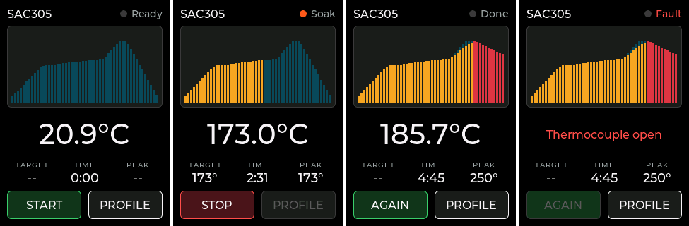

# ProtoBake UI

The oven's touchscreen UI, built with [Rippel](https://github.com/MasonWray/Rippel). It's written in TSX and CSS, previewed in the browser on the real LVGL renderer, and compiled to C for the controller.



## Try it

```bash
cd ui
npm install
npm run dev
```

Open http://localhost:5173. A mock firmware (`src/firmware.mock.ts`) plays the oven: it follows the profile with the prototype's on/off control and a simple thermal model, at 3× real time. Press **START** and a cycle takes about a minute and a half. Use the signals panel to try other states, such as setting `thermocoupleFault` to 1.

`npm run check` runs `rippel check` and the type checker. `npm run build` writes the C into `build/ui`.

## How it splits with the firmware

`src/firmware.contract.ts` is the whole interface. The firmware owns the oven: it reads the thermocouple, runs the control loop, switches the SSR and ends the cycle. The UI shows what the firmware reports and asks it to start or stop.

| Signal | Type | Meaning |
|---|---|---|
| `ready` | bool | Startup finished. The splash screen shows until then. |
| `firmwareVersion` | str(16) | Shown on the splash screen. |
| `ovenDeciC` | i16 | Oven temperature in tenths of a degree C. |
| `thermocoupleFault` | u8 | 0 none, 1 open, 2 shorted to GND, 3 shorted to VCC (the MAX31855's fault bits). |
| `phase` | u8 | 0 idle, 1 preheat, 2 soak, 3 heat, 4 reflow, 5 cool, 6 finished. |
| `elapsedS` | u16 | Seconds since the cycle started. |
| `targetC` | i16 | What the controller is aiming for right now. |
| `heaterOn` | bool | The SSR's state. |

| Action | Meaning |
|---|---|
| `startCycle({ preheatC, preheatS, soakC, soakS, heatC, heatS, reflowC, reflowS, coolC, coolS })` | Run a profile. Each zone ramps linearly from the previous zone's target (from the oven's own temperature, for preheat) to its target over its duration. |
| `stopCycle({})` | Stop and turn the heater off. `phase` goes back to 0. |
| `ackCycle({})` | The user has seen the finished cycle. `phase` goes back to 0. |

The profiles live in `src/profiles.ts`, with the values from the prototype's `ProfileView.cpp`. The UI sends a profile's zones to the firmware when a cycle starts, so the firmware doesn't keep its own copy, and editable profiles would need no firmware change.

Some things differ from the prototype firmware:

- The firmware ends the cycle after the cool zone (`phase` 6) instead of running indefinitely.
- A profile is selected from the start (Sn63/Pb37), rather than "NONE".
- The firmware should stop heating on a thermocouple fault, and should enforce its own maximum temperature, whatever the UI asks for.

## Before it runs on the new board

- **Hardware choices.** `rippel.config.ts` uses the prototype's 2.4" ILI9341 in portrait, and `esp32s3()` as a placeholder MCU. Change them when the board is chosen.
- **Firmware.** `rippel build` writes an ESP-IDF component. Point `output.dir` at the new firmware's `components/ui` once that exists. The firmware supplies the ILI9341 and touch drivers, and calls `ui_set_*` with each new reading. Run the temperature control in its own task so that redrawing the screen can't delay the SSR.
- **The chart.** Rippel has no chart element yet, so the chart is 52 columns of bars: the target curve in blue, and the measured temperature in amber, or red where the oven ran more than 5 °C over target. A real line chart in Rippel would replace it.

The simulator's LVGL heap peaks at about 28 KB.
